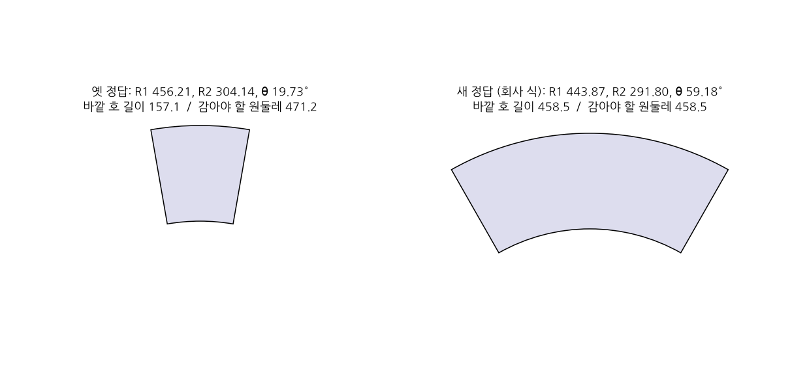
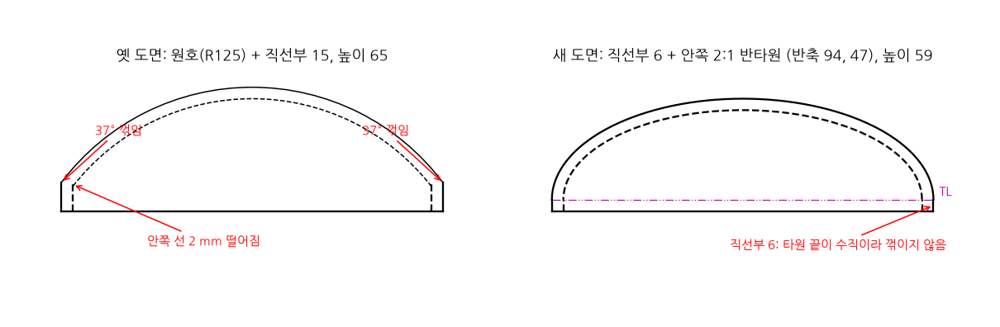

# 합성 도면: 생성기와 정답 식

reader 를 평가할 합성 도면 30장을 만드는 [`scripts/build_synthetic.py`](../../scripts/build_synthetic.py) 의 사용법, 도면을 그리는 규칙, 정답 식과 그 근거를 적는다. 옛 데이터(`data_v3/synthetic`)는 회사 도면에 흔한 쉬운 형상 5종(평판, 굽힘판, 원통, 콘, 경판)을 골라 프로그램으로 그린 도면 30장이다. 동료의 생성기 `make_data_v3.py` 가 그렸는데 이 생성기는 남아 있지 않아 다시 만들 수 없고, 옮겨서 쓴다 ([transfer.md](transfer.md)). 옛 데이터에서 무엇이 왜 틀렸고 새 식은 왜 맞는지는 5절에 있다. 2026-10-27 에 썼다 (`synthetic-generator` 브랜치).

## 1. 만들기와 확인

레포 루트에서 실행한다.

```bash
# 30장을 만든다. 옛 데이터와 전개 값을 나란히 적은 compare.md 도 쓴다
PYTHONPATH=. uv run python scripts/build_synthetic.py --compare data_v3/synthetic

# 사람이 볼 그림 (숨은선·중심선을 선 종류대로 그린 PDF·PNG)
uv run python scripts/render_drawings.py data_v3/generated -o runs/render_drawings/synthetic_generated

# 생성기 테스트
PYTHONPATH=. uv run python -m unittest tests.test_build_synthetic

# 이 문서의 그림 (docs/data/synthetic/*.png)
PYTHONPATH=. uv run python scripts/synthetic_figures.py
```

| 출력 | 내용 |
|---|---|
| `data_v3/generated/<id>/<id>.dxf` | 도면. R2000, mm |
| `data_v3/generated/<id>/<id>.png` | reader 렌더러로 그린 그림. 선 종류(점선·일점쇄선)는 그리지 않는다. reader 의 이미지 입력용이다 |
| `data_v3/generated/<id>/label.json` | 정답 (3절) |
| `data_v3/generated/index.csv` | 도면마다 형상, 치수, 축척, 재질, 전개 값 |
| `data_v3/generated/compare.md` | `--compare` 를 주면 옛 정답과 새 정답의 전개 값과 차이 |
| `runs/render_drawings/synthetic_generated/generated/<id>/<id>.png` | 검토용 그림. 숨은선은 점선, 중심선은 일점쇄선으로 나온다 |

- 옵션: `--out <폴더>` (기본 `data_v3/generated`), `--only <id 일부>` (예: `--only press`), `--no-png`, `-q`.
- `data_v3/` 는 git 에서 뺀다 (`.gitignore` 의 `/data_v3*/`). 생성기로 언제든 다시 만들 수 있다.
- 같은 입력이면 DXF 와 label.json 은 바이트까지 같다 (ezdxf 의 `write_fixed_meta_data_for_testing` 로 저장 시각과 GUID 를 고정한다. `tests/test_build_synthetic.py` 가 확인한다).
- 옛 데이터 `data_v3/synthetic` 은 그대로 둔다. reader 와 실험 스크립트의 기본 입력은 아직 옛 데이터다. 바꾸는 것은 따로 정한다 (7절).

## 2. 도면 규칙

### 2.1 공통

- 도면 1장 = 부품 1개, 3각법 3면도. 정면도는 x(가로)·z(세로), 평면도는 x·y, 우측면도는 y·z 를 보인다. 평면도는 정면도 위, 우측면도는 정면도 오른쪽에 둔다.
- 배치는 용지 mm 로 정하고 축척의 역수 k 를 곱해 부품 mm 로 쓴다. A3 (420 × 297) 에 여백 10 인 틀, 정면도 왼쪽 아래 (50, 55), 뷰 사이 35, 치수선은 외형에서 12, 글자 높이 3, 표제란 (290, 10)–(410, 50). 옛 데이터와 같은 배치다.
- 레이어: `OUTLINE` 외형선, `HIDDEN` 숨은선, `CENTER` 중심선, `DIM` 치수, `TEXT` 주기, `FRAME` 틀, `TITLE` 표제란. 선 종류는 레이어에 붙인다 (HIDDEN, CENTER). `$LTSCALE` = k.
- 치수 4개: 정면도 가로(x)·세로(z), 평면도 세로(y), 우측면도 가로(y). DIMENSION 에 측정값(group 42)을 적고, 치수 블록 안에 치수선·보조선·끝 사선·글자를 LINE 과 TEXT 로 넣는다 (reader 의 `dxf_reader.py` 가 둘 다 읽는다).
- 구멍: 원이 보이는 뷰에 원과 중심선 십자, 옆에서 보이는 뷰에 숨은선 두 줄과 중심선. 구멍 주기 `4-%%c13` 은 원이 보이는 뷰마다 그 뷰의 구멍만 센다. `%%c` 는 DXF 의 Ø 기호다.
- 같은 선은 한 번만 넣는다 (구멍 여러 개가 옆에서 겹쳐 보이면 같은 숨은선이 생긴다).
- 표제란: `PART NAME  <형상>`, `MATERIAL  <재질>, <두께>t`, `SCALE  1/<n>`, `DIM  mm`, `DW'G NO  SYN-000NN`, `A3 (297x420)`, `THIRD ANGLE`. 옛 데이터와 같은 글자·위치다.

### 2.2 형상별

| 형상 | 부품 | 정면도 | 평면도 | 우측면도 |
|---|---|---|---|---|
| flat | 판 length × width × t | 직사각형 L × t, 구멍은 숨은선 | 직사각형 L × W, 구멍 원 | 직사각형 W × t, 구멍은 숨은선 |
| bent_sheet | L 자 90° 굽힘. 수평판 바깥 길이 leg_a, 수직판 바깥 높이 leg_b, 폭 W, 안쪽 굽힘 반경 R | L 자 단면. 바깥 모서리는 반경 R + t 의 호, 안쪽은 반경 R 의 호 (R = 0 이면 꺾인 모서리) | 직사각형 a × W, 수직판 안쪽 모서리 선(x = t) | 직사각형 W × b, 수평판 윗면 선(z = t) |
| cylinder | 축 x, 외경 OD, 길이 L, t | 직사각형 L × OD, 안지름은 숨은선, 축 중심선 | 정면도와 같다 | 두 원 (외경, 안지름. 끝에서 보면 안쪽 모서리도 보인다) |
| cone | 축 z, 큰 쪽이 아래. 대경·소경(외경), 높이 H, t | 사다리꼴. 안쪽 면은 숨은선이고 가로로 t / cos α 안쪽 | 원 4개: 대경, 소경, 위쪽 열린 끝의 안쪽 원(보임), 아래쪽 안쪽 원(숨은선) | 정면도와 같다 |
| press_formed | 2:1 반타원 헤드, 축 z, 열린 쪽이 아래. 외경 OD, t, 직선부 없음 | 바닥선과 반타원 (반축 OD/2, OD/4). 안쪽 면은 반축을 t 씩 줄인 타원(숨은선) | 외경 원, 안지름 원(숨은선) | 정면도와 같다 |

헤드 안쪽 면: 타원을 t 만큼 평행 이동한 곡선은 타원이 아니다. 그래서 도면에서는 반축을 t 씩 줄인 타원으로 그린다. 정답은 바깥 지름과 두께로 계산하므로 이 근사의 영향을 받지 않는다.

## 3. 정답 (label.json)

reader 가 읽는 것은 `class` 와 `flat_pattern` 이다 (`reader/batch.py`, `reader/unfold.py` 의 `evaluate_against_label`). 나머지는 단계별 평가에 쓸 정답이다.

| 키 | 내용 |
|---|---|
| `id`, `class`, `units` | 도면 이름, 형상 (flat, bent_sheet, cylinder, cone, press_formed), `mm` |
| `params` | 형상 치수. 이름은 2.2절 (지름은 모두 외경) |
| `thickness` | 판 두께 |
| `holes` | 구멍마다 축(x, z), 지름, 중심 (부품 좌표) |
| `hole_notes` | 뷰별 구멍 주기 (예: `{"top": "4-Ø13", "right": "4-Ø13"}`) |
| `extents` | 부품 바깥 크기 [x, y, z] |
| `flat_pattern` | 전개 정답. 식(`formula`)과 중간값을 같이 적는다 (4절) |
| `sheet` | 투상법, 축척, 용지, 재질, 도면 번호, 틀 좌표 |
| `views` | 뷰별 도면 좌표 바운딩 박스, 크기 |
| `dimensions` | 치수 4개 (뷰, 축, 값) |
| `files`, `source` | 파일 이름, `scripts/build_synthetic.py` |

`flat_pattern` 의 키 이름은 옛 데이터와 같다. reader 의 채점 코드를 바꾸지 않고 쓸 수 있다.

## 4. 정답 식과 근거

식은 회사 담당자의 계산 기준 문서 [`shell_cone_head_unfold.md`](../../skills/01_core_knowledge/shell_cone_head_unfold.md) 와 [`unfold_rules.md`](../../skills/01_core_knowledge/unfold_rules.md) 를 따른다. 생성기는 이 식을 직접 구현한다. reader 의 전개 코드를 가져다 쓰지 않는다. 그래야 정답과 reader 가 같은 실수를 해도 맞아 보이는 일이 없다.

**평균지름 원칙:** 판을 말거나 성형하면 바깥 면은 늘고 안쪽 면은 줄어든다. 길이가 변하지 않는 것은 두께의 가운데(중립면)뿐이다. 그래서 전개 길이는 평균지름 Dm = 외경 − 두께로 계산한다 (`shell_cone_head_unfold.md` 1.1).

| 형상 | 정답 식 | 예 |
|---|---|---|
| flat | length × width (판 그대로) | flat_0001: 100 × 120 |
| bent_sheet | L = (leg_a − (R + t)) + (leg_b − (R + t)) + BA, BA = (π/2)(R + K·t), K 는 R/t < 1 이면 0.33, 1~3 이면 0.40, 3 이상이면 0.50. 굽힘선은 굽힘부 가운데: (leg_a − (R + t)) + BA/2 | bent_sheet_0007 (100, 100, t 2, R 0): K 0.33, BA 1.037, L = 98 + 98 + 1.037 = 197.04, 굽힘선 98.52 |
| cylinder | length = π × Dm, width = 원통 길이 | cylinder_0013 (OD 100, t 3): π × 97 = 304.73 |
| cone | D1, D2 = 대경·소경의 평균지름, S = √(H² + ((D1 − D2)/2)²), sin α = (D1 − D2)/(2S), R1 = D1/(2 sin α), R2 = D2/(2 sin α), θ = 360° × sin α | cone_0019 (150, 100, H 150, t 4): D1 146, D2 96, S 152.07, sin α 0.1644, R1 444.04, R2 291.97, θ 59.18° |
| press_formed | Db = 1.2 × Dm (2:1 반타원 약산식, 직선부 없음, 트림 여유 없음) | press_formed_0027 (OD 200, t 6): 1.2 × 194 = 232.8 |

검산 방법:

- **콘:** 부채꼴을 말면 바깥 호가 콘 큰 쪽의 원이 된다. 그래서 바깥 호 길이 R1 × θ 가 평균 원둘레 π × D1 과 같아야 한다. cone_0019 는 444.04 × 59.18° = 458.6, π × 146 = 458.7 이다. 생성기가 장마다 이 등식을 검사한다 (`cone_blank` 의 `assert`).
- **헤드:** 2:1 반타원의 중립면 면적은 1.3802 × π(D/2)² 이다. 같은 면적의 원판 지름은 √1.3802 × D = 1.1748 × D 이다 (회사 문서 4.3절의 이론값 1.175). 이 값은 성형 여유가 없는 하한이다. 회사 약산식의 계수 1.2 는 이론값에 성형 여유를 조금 얹은 실무 값이다. v2 계산 skill 도 같은 식을 쓴다 (`cutplan_agent/skills/l3_rules.py` 의 `_head_blank`).
- **reader 와 대조:** reader 의 전개 함수(`reader/unfold.py` 의 `develop`)에 같은 치수를 넣으면 30장 모두 정답과 0.01 이내로 같다 (`test_reader_development_matches_the_labels`). 두 코드는 따로 썼다. reader 의 헤드 식은 2026-10-27 에 경험식(1.25~1.30 × 안지름)에서 이 식으로 바꿨다 (`reader/unfold.py` 의 `head_blank_diameter`). 바꾸기 전에는 헤드 6장이 맞지 않았다.

## 5. 옛 데이터에서 바뀐 것과 이유

옛 데이터는 동료 서버의 생성기(`cutplan_agent_v2 data_v3 generator`, 레포에 없음)로 만든 것이다. 형상·치수·재질·축척은 그대로 가져왔다. 아래는 틀렸거나 바꾼 것이다. 번호는 [../v3_upgrade.md](../v3_upgrade.md) 4절의 이상한 점 번호다.

### 5.1 전개 정답

| # | 무엇 | 옛 식 | 새 식 | 차이 |
|---|---|---|---|---|
| 2 | 콘 부채꼴 | 외경 기준 R1 = R·s/(R − r), 각도 = 360° × (R − r)/R1 | 평균지름 기준, θ = 360° × sin α | 각도가 약 3배 (114~200%) |
| 3 | 헤드 원판 | 1.3415 × D + 2 × flange (1.3415 = √1.8, 근거 모름) | 1.2 × Dm, 직선부 없음 | 16~25% 작아짐 |
| 4 | 굽힘 K 계수 | R = 0 에서도 0.40 | R/t < 1 이면 0.33 (회사 규칙) | 0.07~0.38% |
| 5 | 굽힘선 위치 | 수평판 직선부 끝 (leg_a − t) | 굽힘부 가운데 (+ BA/2) | 0.5~1.6 mm |

**#2 콘은 왜 틀렸나:** 부채꼴은 말았을 때 닫혀야 한다. 바깥 호 길이가 콘 큰 쪽 원둘레와 같아야 한다는 뜻이다. 옛 정답 cone_0019 의 바깥 호 길이는 456.21 × 19.73° = **157.1** 인데, 옛 정답이 쓴 외경의 원둘레는 2π × 75 = **471.2** 다. 원의 1/3 만 감싸는 부채꼴이라 말아도 콘이 되지 않는다. 각도 식의 분모에 경사 길이 S 대신 외측 반경 R1 을 넣은 것으로 보인다 (360° × (R − r)/S = 360° × sin α 가 맞는 식이다). 지름도 외경을 써서 평균지름보다 크다. 새 식은 호 길이 458.6 이 평균 원둘레 458.7 과 맞는다. 6장 모두 같은 식으로 틀렸다 (정답을 `params` 에서 다시 계산해 확인).



**#2 의 영향:** reader 는 이미 회사 식을 쓴다. 동료의 2026-10-18 실행(`runs/reader/deepseek_ocr_qwen_reasoning_skills/flat_patterns.md`)에서 cone_0022 (580.5, 378.9, 44.7°) 와 cone_0023 (321.3, 167.2, 81.8°) 은 새 정답과 같은 값을 냈다. 그런데도 오차 200%, 114% 로 채점됐다. reader 가 맞고 정답이 틀린 것이다.

**#3 헤드는 왜 바꿨나:** 회사 약산식(2:1 반타원 1.2 × Dm + 2·SF)과도, 이론값(1.175 × D)과도 맞지 않는다. 옛 계수 1.3415 는 √1.8 과 소수 넷째 자리까지 같지만 어디서 왔는지 모른다. 옛 도면의 원호 모양(구면 띠)으로 면적을 계산하면 1.118 × D 라서 그것도 아니다. 그리고 #1 로 직선부를 없앴으므로 + 2·SF 항도 없어진다. 차이 16~25% 가운데 직선부 몫(2 × flange = 20~30 mm)이 옛 값의 5~13% 이고, 나머지는 계수(1.3415 → 1.2)와 평균지름(외경 − t) 차이다.

**#4 K 계수:** 회사 규칙(`unfold_rules.md` 30행)은 R/t < 1 이면 K = 0.33 이다. 옛 정답은 굽힘 반경 0 인데도 0.40 을 썼다. reader 의 `k_factor` 도 0.33 을 쓴다. 오차는 1% 안이라 채점 결과를 바꾸지는 않았다.

**#5 굽힘선:** 전개도의 굽힘선은 굽힘부(BA 구간)의 가운데에 긋는다. 옛 정답은 굽힘부 시작점이었다. reader 는 이 값을 채점하지 않는다.

원통과 평판은 옛 정답이 맞았고 값이 그대로다.

### 5.2 도면

| # | 무엇 | 옛 도면 | 새 도면 | 몇 장 |
|---|---|---|---|---|
| 1 | press 윤곽 | 반지름 125 원호 + 높이 15 수직 직선부. 만나는 곳에서 37° 꺾이고, 안쪽 선이 2 mm 떨어져 닫히지 않음 | 2:1 반타원 하나 (ELLIPSE). 직선부 없음 | 6 |
| 6 | 같은 선이 두 번 | 구멍이 옆에서 겹쳐 보일 때 같은 숨은선을 또 넣음 | 한 번만 넣는다 | 10장, 72개 |
| 7 | 구멍 주기 글자 | `2-Ø13` 을 UTF-8 (C3 98) 로 씀. R2000 DXF 는 ANSI(cp1252)로 읽혀 `2-Ø13` 으로 깨짐. reader 도 깨진 글자를 받음 | `2-%%c13` (DXF 의 Ø 기호) | 11 (구멍이 있는 도면 전부) |
| 8 | 콘 안쪽 면 | 안쪽 선이 바깥 선과 평행하지 않음 (cone_0019 에서 가로로 아래 4, 위 2.8 안쪽). 평면도에 위쪽 열린 끝의 안쪽 원이 없음 | 바깥 선과 평행하게, 면에 수직인 두께 t 만큼 (가로로 t / cos α, cone_0019 는 4.06) 안쪽. 위쪽 안쪽 원(보임) 추가 | 6 |
| 9 | 굽힘판 바깥 모서리 | 꺾인 모서리 | 반경 R + t 의 호. 굽힘 반경 0 으로 굽혀도 바깥 면은 두께만큼 둥글다. 정답 식(BA)도 이 모양을 전제로 한다 | 6 |
| 10 | 옆에서 본 구멍 | 숨은선만 | 숨은선 + 중심선 (제도 규칙) | 11 |



**#1 press 는 왜 틀렸나:** 경판(2:1 반타원 헤드)의 단면은 타원의 일부여야 한다. 옛 도면은 양 끝과 꼭대기를 지나는 원호 하나로 그렸고, 원호의 끝 접선(수평에서 53°)과 직선부(90°)가 만나는 곳에서 37° 꺾였다. 실제 헤드에서 직선부(SF)를 두더라도 타원 끝의 접선이 수직이라 꺾이지 않고 이어진다. 2026-10-27 결정으로 직선부는 아예 없앴다. 높이는 외경/4 다.

### 5.3 정답 파일에서 뺀 것

- `wireframe`, `wireframe_reconstructable`: 3D 복원용이다. 3D 단계를 실행에서 뺐다 ([../v3_upgrade.md](../v3_upgrade.md) 1.1).
- `params.flange`, `params.crown_height` (press): 직선부가 없고 높이는 외경/4 로 정해진다.
- `png` 의 픽셀 좌표(`bbox_px`, `px_per_model_mm`), `verified`: 읽는 코드가 없다.
- 옛 `hole_text` (도면 전체 구멍 수 한 줄) 대신 `hole_notes` (뷰별). 굽힘판처럼 구멍이 두 뷰에 나뉘면 한 줄로는 어느 뷰의 구멍인지 알 수 없다.

## 6. 확인한 것 (2026-10-27, `mlic`)

- `tests/test_build_synthetic.py` 7건 통과: 30장 생성, 실행마다 같은 파일, 콘 호 길이 = 평균 원둘레 (6장), 헤드는 타원이고 원호 외형선이 없음, K 계수 0.33, reader 가 치수 4개와 구멍 주기를 읽음(깨진 글자 없음), 중복 선 없음, reader 전개 값과 정답이 같음 (30장, 헤드는 reader 식을 바꾼 뒤).
- reader 를 모델 없이(`--no-vlm`) 새 30장과 옛 30장에 돌려 비교했다. 표제란 정규식 결과(도면 번호, 재질, 두께, 축척)와 뷰 후보 수는 30장 모두 같다. 도면을 쓰는 방식(손으로 쓴 DXF → ezdxf)을 바꿔도 reader 의 읽기는 달라지지 않았다.
- 검토용 그림(`runs/render_drawings/synthetic_generated/`)을 press, 굽힘판, 콘에서 눈으로 봤다.

## 7. 남은 것

- **reader 가 원만 있는 뷰를 놓친다:** cylinder 의 우측면도와 press 의 평면도(동심원과 중심선만 있는 뷰)가 05 `views` 의 뷰 후보에서 빠져 뷰가 2개만 잡힌다. 옛 데이터에서도 같다. reader 문제라 [../v3_upgrade.md](../v3_upgrade.md) 4절에 적었다.
- **표제란 정규식:** `THIRD ANGLE` (투상법)과 `PART NAME` 을 읽지 못한다 (02 의 `missing`). 옛 데이터에서도 같다.
- **기본 입력 바꾸기:** `main.py`, `experiments/*.sh`, `orchestrator.py` 의 기본 입력은 아직 `data_v3/synthetic` 이다.
- **PNG:** reader 렌더러는 선 종류를 그리지 않아 숨은선이 실선으로 보인다 (옛 PNG 도 같다). 이미지 입력 실험에서 문제가 되면 바꾼다.
