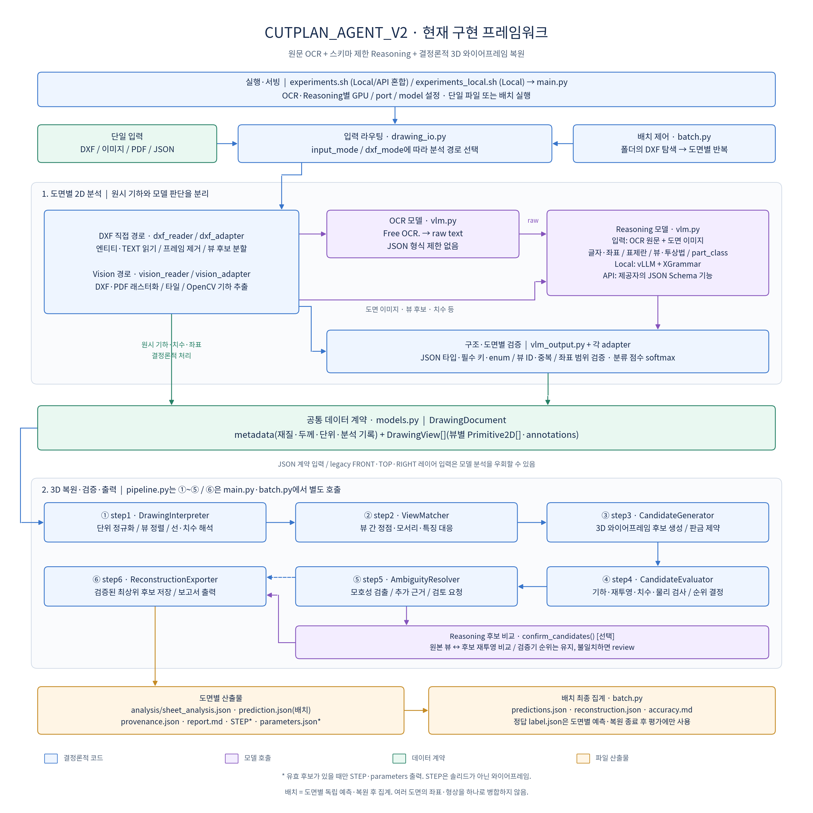

# CUTPLAN_AGENT_V2 구성도

> **위치가 바뀌었다 (2026-10-22, 268b42e).** 이 문서는 동료가 `cutplan_agent_v3/` 시절에 쓴 그대로다. 지금 코드는 `cutplan_agent/reader/` (판독) 와 `cutplan_agent/reconstruct/` (3D 복원) 에, 실험 스크립트는 `experiments/`, 테스트는 `tests/`, 예제 입력은 `tests/fixtures/` 에 있다. 아래의 `python main.py ...` 는 레포 루트에서 `PYTHONPATH=. python cutplan_agent/reader/main.py ...` 로, `bash experiments.sh` 는 `bash experiments/experiments.sh` 로 읽는다. 실행 순서는 [docs/execution_flow.md](../execution_flow.md) 에 정리했다.

현재 구현을 읽어 작성한 도면 단위 처리 흐름이다. 미래 설계나 모델이 추측한 구조가 아니다.



벡터 원본: [framework.svg](framework.svg). 재생성: 프로젝트 루트에서
`../pbl/bin/python docs/render_framework.py` 실행. Matplotlib과 CJK 글꼴 및 fontconfig가 필요하다.
운영 코드·모델 서버를 실행하지 않고 이 문서의 PNG/SVG만 재생성한다.

## 실행 경로

- `experiments.sh`: OCR와 Reasoning 각각 local vLLM / API, GPU, 포트, 모델을 설정한다.
  Reasoning의 기본 출력 모드는 `json_schema`이며 로컬 Reasoning 서버의 기본 백엔드는 XGrammar이다.
- `main.py`: 단일 파일 / 배치, 분석 전용 / 복원, 입력 모드, 후보 확인 여부를 선택한다.
- `batch.py`: 폴더/복수 입력에서 DXF를 탐색한다. 도면마다 클라이언트 trace를 분리하고,
  예측 → 가능한 경우 복원 → 선택적 후보 확인 → 저장을 수행한다. 마지막에 결과와 정확도를 집계한다.
- `drawing_io.py`: JSON은 데이터 계약으로 직접 읽고, 이미지/PDF 및 vision 모드 DXF는
  이미지 어댑터로, dxf 모드 DXF는 엔티티 어댑터로 전달한다. legacy 레이어 경로도 있다.

`main.py`의 CLI 입력 모드 기본값은 `vision`, `experiments.sh`가 전달하는 기본값은 `dxf`이다.
`drawing_io.load_drawing()`을 Python에서 직접 호출할 때 기본값 `auto`는 DXF를 직접 읽는다.
현재 배치 입력 탐색기는 DXF만 지원한다. 이미지/PDF/JSON은 단일 파일 입력 경로에서 지원된다.

## 모델과 결정론적 처리의 경계

1. `dxf_reader.py` / `vision_reader.py`가 원시 기하를 읽는다. Vision 기하는 OpenCV로 추출한다.
2. 어댑터가 표제란 크롭 또는 이미지 타일을 만든다. DXF 직접 경로는 TEXT 정규식 결과를 우선 유지하고,
   미확인 표제란 필드에 OCR·Reasoning을 보조적으로 사용한다. 이미지 타일은 글자 위치도 필요하다.
3. `vlm.read_ocr_task()`가 OCR에 `Free OCR.`를 요청한다. 응답은 JSON 파싱 없는 원문 텍스트다.
4. 원문 전체와 이미지를 Reasoning에 전달한다. `text_extraction`, `title_block` 작업으로
   글자·좌표·종류와 표제란 값을 구조화한다. 별도 `view_labels` 호출은 뷰 분류·투상법·부품 분류를 수행한다.
5. `vlm_output.py`가 JSON 구조·타입·enum 등을 검증하고, 어댑터가 실제 뷰 ID와 좌표 등을 검증한다.
   `vlm.py`의 softmax는 모델이 보고한 클래스 상대 점수에서 계산하며, 모델 내부 토큰 확률이나 보정된 정답 확률이 아니다.
6. `models.py`의 `DrawingDocument`로 정규화한다.

```text
DrawingDocument
├── metadata: 재질 / 두께 / 단위 / 투상법 / 분석·검토 기록
└── views: DrawingView[]
    ├── primitives: Primitive2D[]  (선·원, 좌표, 선 종류, attributes)
    ├── annotations: 치수 등
    └── origin / scale / alignment
```

원시 OCR은 `vlm_trace[].raw`, 검증된 Reasoning JSON은 `vlm_trace[].response`에 남는다.
모델 실패는 결정론적 폴백 또는 검토 항목으로 처리한다. 이미지 글자 위치 구조화가 실패하면
Tesseract로 폴백하므로 해당 실행 파일이 설치되어 있어야 한다.

## 복원 단계

| 단계 | 구현 | 역할 |
|---|---|---|
| 1 | `step1.DrawingInterpreter` | 단위·좌표 정규화, 뷰 정렬, 선·기하·치수 해석 |
| 2 | `step2.ViewMatcher` | 뷰 간 정점·모서리·원 특징 대응 |
| 3 | `step3.CandidateGenerator` | 3D 정점·모서리 후보 및 특징 가설 생성, 판금 제약 |
| 4 | `step4.CandidateEvaluator` | 기하, 재투영, 치수, 물리 조건 검사 및 후보 순위 |
| 5 | `step5.AmbiguityResolver` | 모호성, 추가 근거, 해결 선택지 및 검토 요청 |
| 선택 | `vision_adapter.confirm_candidates` | Reasoning으로 원본 뷰와 후보 재투영 비교, 불일치 시 review |
| 6 | `step6.ReconstructionExporter` | 와이어프레임 STEP, 파라미터, 검증·추적 기록 및 보고서 출력 |

`pipeline.py`는 1~5를 연결한다. 선택적 후보 확인과 6은 `main.py` 또는 `batch.py`에서 호출한다.
Reasoning이 선호 후보를 달리 골라도 검증기의 후보 순위와 출력 후보를 자동 변경하지 않는다.

## 분기와 한계

- `--analyze-only`: 분석/예측 산출물만 저장하고 복원을 건너뛴다.
- 커팅 플랜/네스팅 시트: 판재 목록 `plates`를 기록하며 정투영 복원 대상으로 처리하지 않는다.
- 배치는 `reconstructable=false`이면 `prediction_only`로 복원을 건너뛴다.
  단일 파일 경로는 이 플래그만으로 복원을 자동 생략하지 않으며, 검토 사항으로 남길 수 있다.
- 유효 후보가 없으면 STEP·parameters는 출력하지 않고 검증 보고서를 남긴다.
- `reconstruction.json`은 독립 복원 결과의 인덱스다. 여러 도면으로 하나의 조립체/STEP을 만드는 기능은 아니다.
- 현재 STEP은 선 기반 와이어프레임이며 면·솔리드·홀의 확정 모델이 아니다.
- JSON Schema 강제는 형식 제약이다. 분류·OCR·좌표·형상의 의미적 정답을 보장하지 않는다.
- 실제 현재 구현은 도면별 예측과 복원이 한 루프에서 진행된다. 전체 도면의 예측을 먼저 완료한 뒤
  전체를 한 번에 복원하는 별도 2-pass 스케줄러는 아니다.

## 코드 근거

- 입력·실행: [main.py](../../cutplan_agent/reader/main.py), [experiments.sh](../../experiments/experiments.sh), [drawing_io.py](../../cutplan_agent/reader/drawing_io.py)
- 배치·정답 평가: [batch.py](../../cutplan_agent/reader/batch.py)
- DXF 분석: [dxf_reader.py](../../cutplan_agent/reader/dxf_reader.py), [dxf_adapter.py](../../cutplan_agent/reader/dxf_adapter.py)
- 이미지 분석: [vision_reader.py](../../cutplan_agent/reader/vision_reader.py), [vision_adapter.py](../../cutplan_agent/reader/vision_adapter.py)
- 모델·출력 계약: [vlm.py](../../cutplan_agent/reader/vlm.py), [vlm_output.py](../../cutplan_agent/reader/vlm_output.py)
- 공통 객체·복원: [models.py](../../cutplan_agent/reconstruct/models.py), [pipeline.py](../../cutplan_agent/reconstruct/pipeline.py), [step6.py](../../cutplan_agent/reconstruct/step6.py)
- 제약 생성의 배경: [XGrammar 논문](https://arxiv.org/abs/2411.15100),
  [vLLM Structured Outputs 공식 문서](https://docs.vllm.ai/en/v0.31.0/features/structured_outputs/)

## 사용 예

```bash
# 실제 실행 없이 설정 확인
bash experiments.sh --dry-run

# DXF 직접 분석, OCR raw + Reasoning JSON Schema, 배치 독립 복원
bash experiments.sh --reason-output-format json_schema --output-dir output/framework_example /path/to/dxf_folder

# 기존 모델 서버를 쓰는 단일 이미지 분석 (서버 주소·모델은 환경변수 등으로 설정)
python main.py /path/to/drawing.png --input-mode vision --analyze-only --output-dir output/image_example
```
