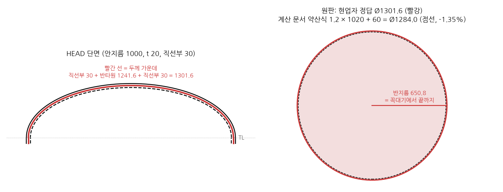
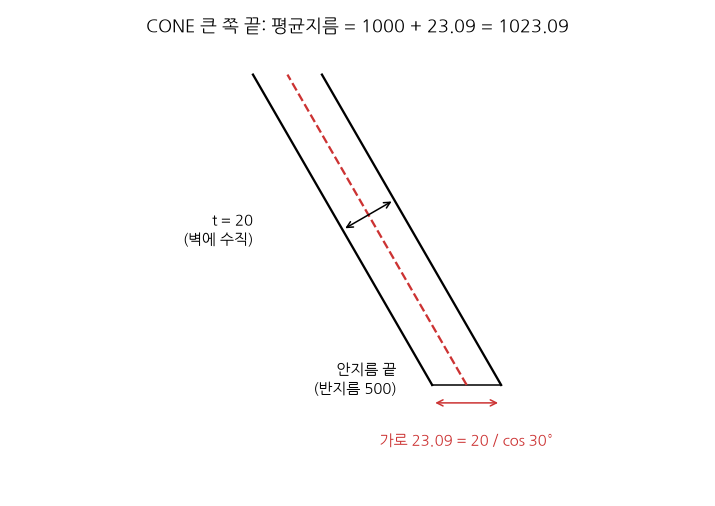

# v3 고도화: 합성 도면부터 다시

2026-10-27 에 목표를 바꿨다. 이 문서는 바뀐 목표, "완벽하게" 의 기준, 계획, 합성 도면에서 찾은 이상한 점과 그 처리를 적는다. 2026-10-28 에 동료와 중간보고 범위를 정했다 (1.2절). 이 문서의 작업 브랜치(`synthetic`, `synthetic-generator`, `colleague-server`)는 2026-10-28 에 main 에 머지했다.

## 1. 무엇이 바뀌었나

- **전:** v3 는 합성 도면(`data_v3/synthetic`)으로 했고 형상 분류 27/30 이 나왔다. 합성 30장은 회귀 테스트로만 두고, 다음 일은 실도면을 부품표부터 읽는 v4 였다 (`git show c71cca0:docs/v4.md`).
- **후:** 지난주 회의 뒤 교수님 피드백으로 목표를 v3 고도화로 바꿨다. 합성 데이터에서 먼저 완벽하게 돈다. v4 내용은 이 브랜치에서 지웠다.
- 합성 도면에서도 27/30 이고, 모델 없이 돌리면 전개(09·10)를 건너뛰며, 단계별로 맞았는지 숫자가 없다. 그리고 합성 도면 자체에 잘못 그린 곳이 있다 (4절). 정답이 단계마다 다 있는 쉬운 세트에서 끝까지 맞히지 못하면, 틀린 원인이 모델인지 하네스인지 코드인지 데이터인지 가릴 수 없다.

### 1.1 범위

도면을 보고 전개도가 나오는 데까지만 한다 (2026-10-27 결정). 3D 모양과 관련된 과정은 모두 뺀다.

| 넣는다 | 뺀다 |
|---|---|
| 01 `read` ~ 10 `develop`: DXF 읽기, 표제란, 뷰, 형상 분류, 전개 파라미터, 전개 계산과 전개도(`flat_pattern.json/.dxf/.png`) | 11 `reconstruct` (3D 와이어프레임 후보), 12 `confirm` (후보 고르기), 13 `export` (`reconstruction.step` 등), `cutplan_agent/reconstruct/` |
| | 06 의 복원 가능 여부 판단, 정답의 `wireframe`·`wireframe_reconstructable` |

3D 코드는 지우지 않고 실행에서만 뺀다. 08 `document` 가 3D 쪽 모델 클래스(`reconstruct/models.py` 의 `DrawingDocument`)를 같이 써서, 지우면 리팩터링이 커지기 때문이다.

- 기본 실행(`main.py`, `main.py --batch`, `stages/run.py`, `orchestrator.py`)에서 11~13 단계 파일은 `skipped` 로 남는다. `reason` 은 `3D stages are off (docs/v3_upgrade.md 1.1); --with-3d runs them` 이다. 배치에서 도면 상태는 `predicted` 다. `report.md`, `provenance.json`, `reconstruction.step`, `parameters.json` 은 생기지 않는다.
- `--with-3d` 를 주면 예전과 같이 돈다. 단계 목록은 `cutplan_agent/reader/stages/workspace.py` 의 `THREE_D` 에 한 번만 있다.
- orchestrator 에는 3D 단계의 tool 이 없다. system prompt 도 10단계만 나열한다 ([reader/orchestrator.md](reader/orchestrator.md) 3절).
- 3D 를 빼기 전후 비교 결과는 커밋 메시지에 적었다. 요약하면 01~10 단계 파일, 전개도, `accuracy.md` 는 같고, `--with-3d` 출력은 빼기 전과 같다.

### 1.2 중간보고 범위 (2026-10-28 동료와 합의)

1. **데이터:** `data_v3/synthetic` 은 회사 도면에 흔한 쉬운 형상 5종(평판, 굽힘판, 원통, 콘, 경판)을 골라 프로그램으로 그린 도면 30장이다. 형상 종류는 회사 도면에서 골랐고, 도면 파일은 동료의 생성기(`make_data_v3.py`, 지금은 남아 있지 않다)가 그렸다. 회사 도면 파일을 그대로 가져온 것은 아니다 (3절의 근거).
2. **결과:** 이 30장에서 로컬 모델(DeepSeek-OCR-2 + Qwen3.6-27B)로 형상 분류 29/30 이 나왔다 (동료 2026-10-15 실행 `xgrammar_batch`).
3. **실패:** 못 맞힌 도면은 모델 답이 잘려 출력 형식(JSON)이 깨진 경우다. 다른 형상으로 잘못 답한 적은 한 번도 없다. 그래서 "쉬운 형상은 잘 분류한다" 고 보고한다. 답 잘림(#13)은 2026-10-28 에 고쳤다 (3.2절).
4. **중간보고는 1~3 만 한다.** 2절의 나머지 기준(뷰, 치수, 전개)과 4절의 남은 이슈는 보고에 넣지 않는다.
5. **실제 도면 읽기는 중간보고 뒤에 한다.** 필요한 데이터(`Data/`, `test_data/cases/`)를 옮기는 법은 [data/transfer.md](data/transfer.md).

보고할 내용, 숫자의 출처, 다시 돌리는 명령은 [interim_report.md](interim_report.md) 에 모았다.

## 2. "완벽하게" 의 기준

합성 30장 전부에서 아래가 성립하면 완주로 본다. 기준은 작업하면서 고치고, 고칠 때마다 날짜를 적는다.

| 항목 | 기준 | 정답 (`label.json`) |
|---|---|---|
| 데이터 | 도면과 정답이 실제 제작 형상과 맞다. 사람이 하나씩 확인했다 (3절) | |
| 단계 | 01~10 단계가 30장 모두 오류·건너뜀 없이 끝난다 | |
| 표제란 | 도면 번호, 축척, 재질, 두께가 정답과 같다 | `sheet.drawing_no`, `sheet.scale_text`, `sheet.material`, `thickness` |
| 뷰 | 뷰 개수와 이름(front, top, right …)이 정답과 같다 | `views` |
| 형상 | 30/30 | `class` |
| 치수 | 형상 파라미터가 정답과 같다 | `params` |
| 전개 | 전개 파라미터가 1% 이내 | `flat_pattern` |
| 모델 | 판단은 로컬 모델(기본 DeepSeek-OCR-2 + Qwen3.6-27B)이 한다 | |
| 재현 | 같은 명령을 다시 돌리면 같은 점수가 나온다 | |

단계별로 맞았는지 재는 코드([harness_engineering.md](harness_engineering.md) 3절 로드맵 2번)가 있어야 이 표를 숫자로 채울 수 있다.

## 3. 계획: 생성기부터

동료에게 생성기를 받기를 기다리지 않고 새로 쓴다 (2026-10-27 결정). 작업 브랜치는 `synthetic-generator` 다.

합성 도면 생성기는 레포에 없다. DXF 첫 줄 주석은 `cutplan_agent_v2 data_v3 generator`, `label.json` 의 출처는 `synthetic:make_data_v3` 인데, 2026-10-27 에 레포 전체, git 이력 전체, `mlic` 홈 아래의 `.py` 를 찾아도 없었다. git 은 원격(`PleaseTakemeAway/pbl`)의 모든 브랜치와 태그를 받아 `git log --all -S` 로 두 문자열을 찾았고, 문서 커밋 하나만 나왔다. 동료 원본인 태그 `archive/cutplan_v3` (253020c, eef59cb, 7199ea6) 와 `archive/data_script` (148e703) 의 파일도 따로 봤다. 판독기, 데이터 스크립트, 그 스크립트들의 `.pyc` 뿐이고, `ezdxf.new` 로 DXF 를 만드는 곳은 테스트의 작은 예제뿐이다. 같은 날 `mlic` 의 `~/노바투스2026` (팀 공유본을 rsync 한 것. `cutplan_agent_v3/`, `Data/`) 도 압축되지 않은 파일 전체를 바이트로 찾았지만 없었다. 이 폴더의 코드 파일은 v3 판독기와 테스트뿐이고 `data_v3/synthetic` 자체도 없다. DXF 주석이 `cutplan_agent_v2` 를 가리키므로 동료 서버의 `/home/hwang/yechanhwang/PBL_2026/cutplan_agent_v2` ([AGENTS.md](../AGENTS.md) 6절) 에 있었을 것이다. 이 레포의 v2 (`cutplan_agent/`) 에는 없다. 같은 날 동료가 `scripts/build_part_class_dataset.py` 를 생성기로 알려 줬지만 다른 데이터셋의 스크립트였다. 이 스크립트는 실제 KDM 커팅플랜에서 잘라낸 부품 전개 DXF(`Data/dataset/KDM/*/*/unfold/`)를 512 px PNG 로 그리고, 부품 이름으로 class (cylinder, cone, head, ring, flat) 를 붙여 `Data/part_class_dataset/` (이미지 ↔ class) 를 만든다. 합성 도면의 형상 5종(flat, bent_sheet, cylinder, cone, press_formed), 3면도, 표제란, `label.json`, `SYN-000NN` 을 만드는 코드는 없다. 레포 판과 동료 원본(태그 `archive/data_script`, 598줄)과 그 `.pyc` 3개를 모두 찾아봤다.

같은 날 동료는 합성 도면이 "만든 것이 아니라 회사 부품 도면 중 쉬운 것을 가져온 것" 이라고 했다. `data_v3/synthetic` 의 파일은 도면을 그대로 가져온 것과는 맞지 않는다 (아래). 2026-10-28 에 동료와 정리한 설명은 "회사 도면에 흔한 쉬운 형상 5종(평판, 굽힘판, 원통, 콘, 경판)을 골라 프로그램으로 그린 도면 30장" 이다 (1.2절). 형상 종류는 회사 도면에서 골랐고 도면은 생성기가 그렸다는 뜻이라 아래 사실과 맞는다.

- 30장 모두 DXF 첫 줄이 `999` 주석 `cutplan_agent_v2 data_v3 generator` 이고, `label.json` 의 `source` 는 `synthetic:make_data_v3`, 도면 번호는 `SYN-000NN` 이다.
- 형상마다 6장의 엔티티 구성이 똑같고 치수만 다르다 (틀에 치수를 넣어 그린 것). 치수는 모두 2~400 mm 의 정수나 .5 다. 실제 부품 1,789개(`Data/part_class_dataset/dataset.csv`)는 긴 변이 중앙값 685 mm, 최대 13,875 mm 다.
- 합성 30장의 전개 크기와 ±1 mm 안에서 같은 실제 부품은 하나도 없다.
- 재질은 SS400, SPHC, SUS304, SPCC, SA516-70 이다. 실제 부품은 A283-C, SA516-70, SA285-C, SA240-316L 순으로 많다. SPCC·SPHC 는 실제 부품표에 거의 없는 박판 재질이다.
- class 가 다르다. 합성은 flat, bent_sheet, cylinder, cone, press_formed 이고, 실제 부품 데이터셋은 cylinder, cone, head, ring, flat 이다.
- 옛 press 도면은 원호가 직선부와 37° 꺾여 만난다 (4.1절). 사람이 CAD 로 그린 경판 도면에서는 나오지 않는 모양이다.

같은 날 밤 동료 서버에서 받은 `cutplan_v2_transfer.tar.gz` 의 `data_v3/README.md` 에서 옛 생성기의 이름이 나왔다: `python tools\make_data_v3.py --out data_v3 --per-class 6 --seed 3`. 이 README 는 데이터를 "generated from the 3D parameters" 라고 적어, 위 판단과 맞는다. 파일 자체는 tar 에 없어 동료 서버에서 찾는다 ([server_handoff.md](server_handoff.md) 2·3절).

1. **생성기를 레포에 새로 쓴다.** 옛 데이터를 재현하지 않는다 (2026-10-27 결정). 옛 정답의 식이 회사 계산 문서와 다르고 틀린 것이 확인돼서(4.2·4.3절), 재현해도 틀린 정답을 다시 만들 뿐이기 때문이다. 형상·치수·재질·축척은 옛 데이터와 같게 두고, 그리는 법과 정답 식만 회사 기준으로 새로 썼다: [`scripts/build_synthetic.py`](../scripts/build_synthetic.py), 설명은 [data/synthetic.md](data/synthetic.md). 옛 정답과의 차이는 `--compare` 로 만드는 `compare.md` 에 있다.
2. **형상별로 하나씩 검증한다.** 도면(3면도, 숨은선, 치수)과 정답(`params`, `flat_pattern`)이 실제 제작 형상과 맞는지 사람이 보고, 틀린 곳은 4절에 적는다.
3. **고친다.** 생성기를 고쳐 데이터를 다시 만든다. 한 커밋에 한 문제만 고치고, 바뀐 도면과 정답을 커밋 메시지에 적는다. 전개 식이 바뀌면 reader 의 전개 코드(`cutplan_agent/reader/unfold.py`)도 같이 본다.
4. **새 데이터로 reader 를 다시 잰다.** 동료의 27/30 은 옛 데이터의 점수이므로 새 데이터의 기준선을 다시 만든다. 2026-10-27 에 만들었다 (3.1절).

### 3.1 새 데이터의 기준선 (2026-10-27, `mlic`)

`synthetic-generator` 브랜치의 reader 로 `data_v3/generated` 30장을 로컬 모델(DeepSeek-OCR-2 + Qwen3.6-27B, `experiments/serve.sh` 기본 구성)로 돌리고 2절 기준으로 채점했다. 명령은 [reader/quickstart.md](reader/quickstart.md) 5절이다.

```zsh
experiments/batch_parallel.sh data_v3/generated runs/reader/gen1027/local_new 3
uv run python scripts/reader/score_synthetic.py runs/reader/gen1027/local_new
```

| 항목 | 전체 | flat | bent_sheet | cylinder | cone | press_formed |
|---|---:|---:|---:|---:|---:|---:|
| 단계 (01~10 모두 done) | 26/30 | 5/6 | 6/6 | 3/6 | 6/6 | 6/6 |
| 표제란 | 30/30 | 6/6 | 6/6 | 6/6 | 6/6 | 6/6 |
| 뷰 | 17/30 | 5/6 | 6/6 | 0/6 | 6/6 | 0/6 |
| 형상 | 26/30 | 5/6 | 6/6 | 3/6 | 6/6 | 6/6 |
| 치수 | 17/30 | 5/6 | 2/6 | 3/6 | 2/6 | 5/6 |
| 전개 (1% 이내) | 13/30 | 5/6 | 3/6 | 3/6 | 2/6 | 0/6 |
| 전부 | 8/30 | 4/6 | 2/6 | 0/6 | 2/6 | 0/6 |

- 도면별 결과와 틀린 이유: `runs/reader/gen1027/local_new/score.md`. 30장에 약 25분 (3묶음 동시, 16:07~16:32).
- 모델 없이(`--no-vlm`, `runs/reader/gen1027/novlm_new`): 표제란 30/30, 뷰 18/30, 나머지 0 (형상은 모델만 정한다).
- 형상을 답한 26장은 모두 맞았다. 못 맞힌 4장은 13번. 같은 코드를 동료 서버(GPU 한 장씩)에서 돌리면 형상 30/30 이다 (2026-10-28, [server_handoff.md](server_handoff.md) 6.3절). 어느 도면이 잘리는지가 실행마다 달라서다. 13번을 고친 뒤는 3.2절.
- 틀린 원인은 4절 13~18번이다. 11번(원만 있는 뷰)은 뷰 13장 중 12장의 원인이다.
- 처음에는 10묶음으로 돌렸는데 KV 캐시가 차서 생성 속도가 25 → 4.5 tok/s 로 떨어지고 06 단계 요청이 120초 제한(`VLMConfig.timeout`)에 걸려 `ReadTimeout` 이 났다. 그 결과는 버렸다. 제한 시간은 이제 `CUTPLAN_{OCR,REASON}_TIMEOUT` 으로 바꿀 수 있고, `batch_parallel.sh` 가 900초로 둔다. 기준선 실행에는 `ReadTimeout` 이 없다.
- 1% 기준의 한계: bent_sheet_0008 은 모델이 굽힘 반경 0 을 6 (= 두께)으로 읽었는데 전개 길이 오차가 0.73% 라 전개는 맞음으로 나온다. 그래서 치수를 따로 본다.
- 동료의 2026-10-18 결과(옛 데이터, 형상 27/30, 전개 11/30)와 같은 저울은 아니다. 옛 정답은 콘·경판이 틀려서 전개 점수가 낮게 나왔다.

### 3.2 답 잘림(#13)을 고친 뒤 (2026-10-28, 동료 서버)

#13 을 두 군데서 고쳤다.

- **판단 서버:** `experiments/vllm_common.sh` 가 reason 역할에 `--structured-outputs-config.disable_any_whitespace=true` 를 붙인다. 스키마 문법이 JSON 사이의 공백을 허용해서 모델이 빈 줄을 `max_tokens` 까지 반복하던 경우를 막는다. 2026-10-28 이후 띄운 서버에만 적용된다.
- **클라이언트:** `cutplan_agent/reader/vlm.py` 의 `VLMClient.ask` 는 스키마 출력이 `max_tokens` 에서 잘리면 (`finish_reason` `length`, Anthropic `max_tokens`) "모든 reason·note 를 한 문장으로" 라는 지시를 붙여 한 번 더 묻는다. 잘린 첫 답은 기록의 `retry` 에 남는다. 잘리지 않았는데 JSON 이 아닌 답(산문, 코드 펜스)은 예전처럼 다시 묻지 않고 실패로 둔다. 모든 모델 호출 기록에 `finish_reason` 이 생겼다.

같은 서버(GPU 4·5)·같은 명령(`batch_parallel.sh ... 3`)으로 옛·새 데이터를 두 번씩 돌렸다. 결과는 `runs/reader/fix13/{old,new}_{1,2}`.

| 실행 | 형상 | 다시 물은 도면 (모두 두 번째에 성공) | 06 최장 시간 |
|---|---:|---|---:|
| 고치기 전 `server1027/v3_old` (옛) | 29/30 | (없음, flat_0002 잘림) | 72.6 s |
| `fix13/old_1` (옛) | 30/30 | 없음 | 54.8 s |
| `fix13/old_2` (옛) | 30/30 | 없음 | 61.1 s |
| 고치기 전 `server1027/v3_new` (새) | 30/30 | (없음) | 54.2 s |
| `fix13/new_1` (새) | 30/30 | press_formed_0026 | 86.7 s |
| `fix13/new_2` (새) | 30/30 | cylinder_0017 | 87.1 s |

- 공백을 막은 뒤에도 `reason` 을 길게 쓰다 잘리는 경우가 새 데이터에서 실행마다 1장씩 있었고, 다시 묻기가 둘 다 살렸다.
- 새 데이터의 나머지 점수 (`new_1` / `new_2`): 단계 30/30, 표제란 30/30, 뷰 15/30, 치수 21 / 22, 전개 15 / 16, 전부 8 / 9. 뷰·치수·전개의 남은 오류는 4절 #11, #14~#18 이다.
- 3묶음 동시로 30장에 약 12분 걸렸다 (옛·새 데이터를 같이 돌려 6묶음이 한 서버를 나눠 썼다).

## 4. 이상한 점

합성 도면에서 찾은 이상한 점을 하나씩 적는다. 처리는 코드(생성기·reader), 정답, 지식 문서 중 무엇을 고쳤는지 적는다.

| # | 날짜 | 이상한 점 | 어디서 | 처리 | 상태 |
|---|---|---|---|---|---|
| 1 | 2026-10-27 | press_formed 경판 윤곽이 타원이 아니고, 직선과 만나는 곳에서 꺾인다 | `press_formed_0025`~`0030` 6장, 정면도·우측면도 | 생성기: 직선부 없는 2:1 반타원 (4.1절, [data/synthetic.md](data/synthetic.md) 5.2절) | 고침 |
| 2 | 2026-10-27 | 콘 전개 정답이 틀렸다. 반경은 외경 기준이고 각도는 다른 식이다 | `cone_0019`~`0024` 6장, `flat_pattern` | 생성기: 회사 식 (4.2절, data/synthetic.md 5.1절) | 고침 |
| 3 | 2026-10-27 | press_formed 블랭크 지름 정답의 계수(1.3415)가 회사 계산 문서와 다르다 | press_formed 6장, `flat_pattern.blank_diameter` | 생성기와 reader: 1.2 × Dm (4.3절, data/synthetic.md 5.1절). 2026-10-28 에 현업자 정답대로 두께 가운데 반타원 길이로 다시 바꿈 (5.4절) | 고침 |
| 4 | 2026-10-27 | 굽힘 K 계수가 회사 규칙과 다르다 (R = 0 인데 0.40, 규칙은 0.33) | bent_sheet 6장 | 생성기: 회사 규칙 (data/synthetic.md 5.1절) | 고침 |
| 5 | 2026-10-27 | 굽힘선이 굽힘부 가운데가 아니라 시작점에 있다 | bent_sheet 6장, `flat_pattern.bend_lines` | 생성기 (data/synthetic.md 5.1절) | 고침 |
| 6 | 2026-10-27 | 같은 숨은선이 두 번씩 들어 있다 | 10장, 72개 | 생성기 (data/synthetic.md 5.2절) | 고침 |
| 7 | 2026-10-27 | 구멍 주기 `2-Ø13` 이 `2-Ø13` 으로 깨진다 (UTF-8 로 썼는데 R2000 은 cp1252 로 읽힘) | 구멍이 있는 11장 | 생성기: `%%c` (data/synthetic.md 5.2절) | 고침 |
| 8 | 2026-10-27 | 콘 안쪽 면이 바깥 면과 평행하지 않고, 평면도에 위쪽 안쪽 원이 없다 | cone 6장 | 생성기 (data/synthetic.md 5.2절) | 고침 |
| 9 | 2026-10-27 | 굽힘판 바깥 모서리가 꺾여 있다 (굽히면 바깥 면은 반경 R + t 로 둥글다) | bent_sheet 6장 | 생성기 (data/synthetic.md 5.2절) | 고침. 확인 필요 |
| 10 | 2026-10-27 | 옆에서 본 구멍에 중심선이 없다 | 구멍이 있는 11장 | 생성기 (data/synthetic.md 5.2절) | 고침 |
| 11 | 2026-10-27 | reader 가 원만 있는 뷰를 뷰 후보에서 놓친다 (뷰 3개 중 2개만 잡힘) | cylinder 우측면도, press 평면도. 옛·새 데이터 모두 | reader 05 `views` | 남음 |
| 12 | 2026-10-27 | reader 표제란 정규식이 `THIRD ANGLE` 과 `PART NAME` 을 읽지 못한다 | 30장 모두. 옛·새 데이터 모두 | reader 02 `title_regex` | 남음 |
| 13 | 2026-10-27 | 06 의 모델 답이 잘려 JSON 이 깨진다 (공백을 수천 줄 반복하거나 `reason` 을 길게 쓰다 `max_tokens` 1500 에 걸림). 형상이 None 이 돼 09·10 을 건너뛴다 | cylinder_0013·0016·0017, flat_0002 (3.1절 기준선). 동료의 29/30·27/30 과 동료 서버 재실행에서 못 맞힌 도면도 모두 이것이다 ([server_handoff.md](server_handoff.md) 6.3절) | 하네스: 판단 서버에 `disable_any_whitespace` (공백 반복 차단), `max_tokens` 에서 잘리면 짧게 한 번 다시 묻기 (`reader/vlm.py`, 2026-10-28, 3.2절) | 고침 |
| 14 | 2026-10-27 | 09 에서 모델이 콘 대경을 외경 그대로 `large_inner_dia` 에 넣는다 (소경은 모델이 비워 fallback 이 외경 − 2t 로 맞게 채움) | cone_0019~0022 | 하네스: 외형 치수와 대조 | 남음 |
| 15 | 2026-10-27 | 09 에서 모델이 2:1 타원형 경판을 `HEMI` 로 판단해 계수 1.414 를 쓴다. press_formed_0025 는 외경을 안지름으로 읽었다 | press_formed_0025~0028·0030 | 하네스: 높이/지름 = 1/4 이면 2:1 | 남음 |
| 16 | 2026-10-27 | `fallback_params` 가 직선부 없는 새 경판 도면에서 타원 끝을 직선부(`side_height`) 2.4~3.6 mm 로 잰다 | press_formed 6장 | reader `unfold.py` 의 `_front_profile`·`fallback_params` | 남음 |
| 17 | 2026-10-27 | 09 에서 모델이 굽힘판 폭과 다리 길이를 바꿔 읽거나(0009·0010), 굽힘 반경 0 을 두께로 읽는다(0008·0011) | bent_sheet 4장 | 하네스: 외형 치수와 대조 | 남음 |
| 18 | 2026-10-27 | 06 에서 평면도를 `bottom` 으로 이름 붙였다 | flat_0006 | 모델 | 남음 |

### 4.1 press_formed 경판 윤곽 (#1)

지적: 경판은 단면이 타원의 일부만 나와야 하고, 중간에 직선으로 꺾인 곳이 있으면 안 된다.

`press_formed_0027` (지름 200) 의 정면도를 ezdxf 로 읽은 결과다. 6장 모두 엔티티 구성이 같다.

| 선 | 레이어 | 기하 |
|---|---|---|
| 아래 테두리 | OUTLINE | 직선 (100,110)–(300,110) |
| 양쪽 직선부 | OUTLINE | 수직 직선, 높이 15 (`params.flange`) |
| 바깥 윤곽 | OUTLINE | **원호**, 중심 (200,50), 반지름 125, 36.87°–143.13° |
| 안쪽 윤곽 | HIDDEN | 원호, 같은 중심, 반지름 119, 37.82°–142.18° |
| 안쪽 직선부 | HIDDEN | 수직 직선 x=106·294, 높이 15 |

- **타원이 아니라 원호다.** 크라운 높이가 지름의 1/4 (`crown_height` 50 = 200/4) 이라 2:1 반타원 경판을 뜻하는 것으로 보이는데, 윤곽은 양 끝과 꼭대기를 지나는 원호 하나로 그렸다.
- **직선부와 만나는 곳에서 꺾인다.** 원호의 끝 접선은 수평에서 약 53° 이고 직선부는 90° 라서 약 37° 꺾인다. 반타원이면 끝 접선이 수직이라 직선부와 매끄럽게 이어진다.
- **안쪽 윤곽이 닫히지 않는다.** 안쪽 원호의 끝은 y≈123 인데 안쪽 직선부의 위 끝은 y=125 라 약 2 mm 떨어져 있다. 안쪽 원호를 바깥 원호와 같은 중심으로 반지름만 줄여 그렸기 때문이다.
- **정답 블랭크 지름도 같이 봐야 한다.** 6장 모두 `flat_pattern.blank_diameter` = 1.3415 × 지름 + 2 × `flange` 로 맞는다 (예: 1.3415 × 200 + 2 × 15 = 298.3). 어디서 온 계수인지 모른다. 윤곽을 고치면 블랭크 식도 회사 계산 문서(`skills/01_core_knowledge/shell_cone_head_unfold.md`)와 맞춰 다시 정해야 한다.
- **고치는 방향 (2026-10-27 결정):** 직선부를 없애고 2:1 반타원만 그린다. `params.flange` 는 없앤다. 높이는 크라운 높이(지름/4) 하나다.

### 4.2 콘 전개 정답 (#2)

`label.json` 의 `flat_pattern` 을 `params` 에서 거꾸로 계산하면 6장 모두 아래 식과 소수 둘째 자리까지 같다. R = 대경/2, r = 소경/2 (외경), H = 높이다.

- 경사 길이 s = √(H² + (R − r)²)
- 외측 반경 = R·s/(R − r), 내측 반경 = r·s/(R − r)
- 각도 = 360°·(R − r)/외측 반경

회사 계산 문서(`skills/01_core_knowledge/shell_cone_head_unfold.md` 3.1.1)와 두 곳이 다르다.

- **지름:** 회사 식은 평균지름(외경 − 두께)을 쓴다 (같은 문서 1.1). 정답은 외경을 쓴다.
- **각도:** 회사 식은 θ = 360°·sin α = 360°·(R − r)/s 다. 정답은 분모에 s 대신 외측 반경을 넣어서 각도가 약 1/3 로 작다.

| 도면 | 정답 (외측, 내측, 각도) | 회사 식, 평균지름 (외측, 내측, 각도) |
|---|---|---|
| cone_0019 | 456.21, 304.14, 19.73° | 444.04, 291.97, 59.18° |
| cone_0020 | 618.47, 412.31, 29.10° | 610.22, 404.06, 87.31° |
| cone_0021 | 283.02, 188.68, 63.60° | 279.25, 184.91, 190.80° |
| cone_0022 | 604.67, 403.11, 14.88° | 580.48, 378.93, 44.65° |
| cone_0023 | 330.06, 176.03, 38.17° | 321.26, 167.23, 81.80° |
| cone_0024 | 618.47, 412.31, 29.10° | 612.28, 406.13, 87.31° |

reader 는 회사 식을 쓴다 (`cutplan_agent/reader/unfold.py` 의 `cone_frustum`: θ = π·D1m/R1). 동료의 2026-10-18 실행 `runs/reader/deepseek_ocr_qwen_reasoning_skills/flat_patterns.md` 에서 콘 6장은 모두 전개됐지만 정답과의 오차가 114~246% 였다. cone_0022 (580.5, 378.9, 44.7°) 와 cone_0023 (321.3, 167.2, 81.8°) 은 위 표의 회사 식 값과 같다. reader 가 맞게 계산했는데 정답이 틀려서 0점이 된 것이다.

**검토 (2026-10-27):** 회사 식이 맞다. 부채꼴의 바깥 호 길이는 콘 대경 쪽 원둘레와 같아야 한다. cone_0019 에서 정답의 호 길이는 456.21 × 19.73° = 157.1 인데, 외경 원둘레는 471.2 다. 반경 차(R − r)의 원둘레만큼만 감싸는 각도다. 회사 식은 444.04 × 59.18° = 458.6 이고 평균지름 원둘레 π × 146 = 458.7 과 같다. 평균지름을 쓰는 이유는 두께 중앙(중립면) 길이가 굽힌 뒤에도 변하지 않기 때문이다 (같은 문서 1.1).

### 4.3 press_formed 블랭크 지름 정답 (#3)

4.1절에 적은 대로 정답은 블랭크 지름 = 1.3415 × 지름 + 2 × `flange` 다. 회사 계산 문서 4.2절의 2:1 반타원형 약산식은 Db ≈ 1.2 × Dm + 2·SF (Dm 은 평균지름, 계수 범위 1.18~1.2) 이고, 4.3절의 이론값은 약 1.175 × D 다. 1.3415 는 어느 쪽과도 맞지 않는다. 동료 실행에서 reader 의 값은 정답보다 4~10% 작았다 (같은 `flat_patterns.md`). 윤곽을 직선부 없는 반타원으로 바꾸면(4.1절) SF 항도 없어지므로, 블랭크 식은 그때 같이 정한다.

**검토와 결정 (2026-10-27):** 아래 권장대로 회사 약산식 1.2 × Dm 으로 정했다.

- 정답 계수 1.3415 는 √1.8 = 1.34164 와 같다 (1.34164 × 200 + 30 = 298.3). 왜 √1.8 인지는 모른다. 원호로 그린 지금 윤곽의 면적에서 나온 값도 아니다 (구면 띠 면적이면 1.118 × D).
- 2:1 반타원 중립면 면적을 계산하면 A = 1.3802·πa² 이고, 원판 지름은 √1.3802 × D = 1.1748 × D 다. 회사 문서 4.3절의 이론값 1.175 와 같다. 성형 여유가 없는 하한이다.
- 회사 약산식은 1.2 × Dm + 2·SF 다 (계수 범위 1.18~1.2). 이론값에 성형 여유를 얹은 실무 값으로 읽힌다. v2 계산 skill 은 이미 이 식을 쓴다 (`cutplan_agent/skills/l3_rules.py` 의 `_head_blank`, 2026-10-23 부터). smoke test 의 6132.2 kg 이 이 식으로 나온 값이다.
- reader 는 1.25~1.30 × ID (가운데 1.275) 라는 경험식을 썼다 (`reader/unfold.py` 의 `HEAD_BLANK_K`). 회사 식으로 바꾸지 않은 이유는 합성 정답에 맞추기 위해서였다. 정답을 고치면서 이 이유가 없어져 2026-10-27 에 회사 식으로 바꿨다 (`head_blank_diameter`).
- 그래서 정답, reader, v2 를 모두 회사 약산식 1.2 × Dm 으로 맞추는 것을 권한다. 직선부가 없으므로 SF 항은 0 이다. 트림 여유(20~50 mm)는 제작사마다 달라서 정답에 넣지 않는다.

**2026-10-28 에 바뀜:** 현업자 정답 전개도(`data_v3/20261027example` 의 HEAD)는 두께 가운데 반타원의 길이 + 2·SF 를 쓴다. 사용자 결정으로 현업자 정답을 따라 정답과 reader 를 이 식으로 바꿨다. v2 는 그대로다. 이유와 비교는 5.4절.

## 5. 다음: 현업자가 그린 시험 도면 3건 (2026-10-28 계획)

2026-10-27 에 회사 현업자가 합성 도면과 비슷하게 직접 그린 도면 3건을 받았다. `data_v3/20261027example/` 에 두었고 git 에서 뺐다 (확인은 `scripts/check_data.py`). 다음 작업은 이 3건에서 v3 가 얼마나 맞히는지 재는 것이다. 형상 분류가 주 목표이고, 전개(09·10)는 정답 전개도가 있으니 같이 재며, 커팅플랜 계산은 선택이다.

### 5.1 세트의 역할

| 세트 | 역할 | 쓰는 법 |
|---|---|---|
| `data_v3/generated` (합성 30장, 회사 기준 정답) | 개발 세트 ("training set") | 하네스(프롬프트, 규칙, fallback)를 고치고 다시 잰다. 모델 가중치를 학습하지는 않는다 |
| `data_v3/synthetic` (옛 합성 30장) | 중간보고 기준 (1.2절) | 형상 점수만 비교한다. 콘·경판·굽힘판 정답이 틀려 있다 |
| `data_v3/20261027example` (사람이 그린 3건) | 시험 세트 ("test set") | 재기만 한다. 이 3건을 보고 하네스를 고치면 시험 점수가 의미를 잃는다. 고칠 점이 보이면 개발 세트에 같은 경우를 만들어 거기서 고친다 |

### 5.2 들어 있는 것

부품마다 입력 도면과 정답 전개도가 DWG 와 PDF 로 있다 (12개 파일, `CONE.dwg`, `CONE 전개도 정답.dwg` 식). 세 부품 모두 안지름 1000, 두께 20, 재질 A516-70 이다. 정답 전개도에는 모두 "철판두께의 가운데를 기준으로 산출됨" 이라고 적혀 있다. 아래 값은 2026-10-28 에 LibreDWG 0.14 로 DXF 로 바꿔 읽은 것이다 (6개 모두 변환되고 ezdxf 로 열린다, DWG 버전 R2007).

| 부품 | 형상 class | 도면 | 정답 전개 | 우리 식 (`build_synthetic.py`·`reader/unfold.py`) | 차이 |
|---|---|---|---|---|---|
| SHELL | cylinder | 원 1000·1040, 길이 1500 | 3204.4 × 1500 ("1020 x Pi") | π × (1000 + 20) = 3204.4 | 0 |
| CONE | cone | 큰 쪽 원 1000·1046.2, 작은 쪽 422.6·468.8 (벽이 수평으로 23.09 = 20 / cos 30°) | 부채꼴 R1 1023.09, R2 445.75, θ 180.0° | 평균지름 = 안지름 + t → R1 1020.0 | −0.3% |
| HEAD | press_formed | 2:1 ELLIP. HEAD, 원 1000·1040, 깊이 250, 직선부 30 (TL) | 원판 지름 1301.6 = 1241.6 (반타원 길이) + 30 + 30 | 1.2 × 1020 + 2 × 30 = 1284.0 | −1.35% |

- 콘 정답은 평균지름을 수평으로 잰다: 안지름 + t / cos α = 1000 + 23.09. 각도 180° = 360° × sin 30° 와 R1 = D1 / (2 sin α) 는 회사 식(4.2절)과 같다.
- 경판 정답의 1241.6 은 두께 가운데 타원(장반경 500 + 10, 단반경 250 + 10)의 반 둘레다 (수치 적분으로 확인). 회사 계산 문서의 1.2 × Dm 은 면적이 같아지는 원판의 근사식이다 (4.3절).

### 5.3 돌리기 전에 정할 것

**2026-10-28 결정: 현업자 정답이 기준이다.** 회사 현업자가 그린 정답 전개도와 회사 계산 문서가 다르면 현업자 정답을 따른다. 사용자가 계산 문서를 직접 검토해 판단을 줄 때까지 이 기준으로 한다. 그래서 1·3 은 현업자 정답에 맞춰 생성기와 reader 를 고쳤다 (5.4절).

1. **경판 원판 식이 둘이다.** 회사 계산 문서(`skills/01_core_knowledge/shell_cone_head_unfold.md`)는 1.2 × Dm + 2SF, 현업자 정답은 두께 가운데 반타원 길이 + 2SF 다. 이 도면에서 1.35% 달라 2절의 1% 기준을 넘는다. → 2026-10-28 현업자 정답으로 바꿨다. 생성기(`head_blank`), reader(`head_blank_diameter` 의 2:1), 합성 헤드 도면(2:1 을 안쪽 면 기준으로), 지식 문서에 메모. 4.3절의 1.2 × Dm 결정은 이것으로 바뀌었다.
2. **경판에 직선부가 있다.** HEAD 도면은 TL 위로 직선부 30 을 그렸다. 합성 생성기는 2026-10-27 에 직선부를 없앴다 (#1). 시험 도면에서는 reader 가 직선부를 재야 하므로 #16 (`fallback_params` 의 직선부 측정)이 다시 중요하다. 개발 세트에 직선부 있는 경판을 더할지 정한다.
3. **콘 평균지름.** 수평(t / cos α)과 우리(t)의 차이는 0.3% 로 1% 기준 안이다. → 2026-10-28 현업자 정답대로 가로로 잰다 (생성기 `cone_blank`, reader `develop` 과 `fallback_params`). 다만 받은 커팅플랜 D-1203 의 콘은 안지름 기준이다 (5.4절). 이 충돌은 사용자 검토 때 본다.
4. **도면 형식이 합성과 다르다.** DWG 라 00 `convert` 부터 돌린다 ([reader/quickstart.md](reader/quickstart.md) 2절). 표제란은 부품표 칸(NO., PART NAME, SIZE / DIMENSION, MATERIAL, Q'TY, UNIT)이고 도면 번호와 축척 글자가 없다. 두께는 `t20` 으로 적혀 있다. 뷰 이름이 글자로 있다 (`<TOP VIEW>`, `<FRONT VIEW>`, `<SIDE VIEW>`). 그래서 2절의 표제란·뷰 기준을 이 세트에 맞게 다시 정해야 한다.
5. **정답 파일이 없다.** `scripts/reader/score_synthetic.py` 는 `label.json` 을 읽는다. 정답 전개도의 값(class, 전개 치수)을 `label.json` 형식으로 옮길 곳과 방법을 정한다. 원본 12개 파일은 그대로 둔다 (`check_data.py` 기준이 원본 기준이다).

### 5.4 왜 다르고, 무엇으로 바꿨나 (2026-10-28)

**헤드 (경판).** 원판(평평한 원)을 눌러 헤드를 만든다. 이때 판의 바깥 면은 늘고 안쪽 면은 줄지만 두께 가운데 선은 길이가 그대로라고 본다. 그러면 원판의 중심에서 가장자리까지(반지름)가 헤드의 꼭대기에서 끝까지의 두께 가운데 선 길이가 된다. 현업자 정답이 이 방법이다 (자오선 길이법). 회사 계산 문서는 다른 방법이다. 원판의 넓이 = 헤드 두께 가운데 면의 넓이로 놓고(면적 동등법, 계산 문서 4.1) 거기서 나온 1.175 × D 에 여유를 붙인 약산식이 1.2 × Dm 이다. 두 방법은 같은 헤드에서 다른 값을 낸다. 길이법이 조금 크다.



| 헤드 | 안지름, t, 직선부 | 실제 값 | 길이법 (새 식) | 1.2 × Dm + 2SF (옛 식) |
|---|---|---:|---:|---:|
| 현업자 HEAD (`data_v3/20261027example`) | 1000, 20, 30 | 1301.6 | 1301.6 (0) | 1284.0 (−17.6) |
| D-1203 HEAD 2:1 (받은 커팅플랜) | 3700, 23, 38 | 4590 | 4592.0 (+2.0) | 4543.6 (−46.4) |
| S-2120 TOP HEAD 2:1 | 1500, 10, 27 | 1890 | 1885.9 (−4.1) | 1866.0 (−24.0) |
| S-2120 BTM HEAD 2:1 | 1500, 8, 27 | 1878 | 1882.8 (+4.8) | 1863.6 (−14.4) |

- 받은 커팅플랜의 헤드 3개도 길이법과 ±5 mm 로 맞는다 (치수는 [data/cutplan_cases.md](data/cutplan_cases.md) 6절). 커팅플랜 값에 트림이 들어 있는지는 모른다. 1.2 × Dm 은 셋 다 14~46 mm 작다. v2 코드(`skills/l3_rules.py`)는 여기에 트림 30 을 더해 20 mm 안으로 맞췄었다.
- 두께 가운데 타원의 반축: 2:1 헤드는 안쪽 깊이가 안지름/4 다. 두께 가운데는 안쪽 면에서 t/2 바깥이라 반축은 (ID + t)/2, ID/4 + t/2 다 (현업자 HEAD: 510, 260 → 반 둘레 1241.6).
- 합성 헤드 도면도 2:1 을 안쪽 면 기준으로 바꿨다 (현업자 도면이 안지름 1000, 안쪽 깊이 250 으로 치수를 넣었다). press 6장의 높이가 외경/4 에서 안지름/4 + t 로 늘었다 (press_formed_0027: 50 → 53).

**콘.** 판 두께 t 는 벽에 수직으로 잰 값이다. 콘의 벽은 기울어 있어서, 끝면(바닥)에서 가로로 자르면 판이 t / cos α 만큼 넓게 보인다. 현업자 정답은 평균지름을 이 가로 두께의 가운데로 잰다: 1000 + 20 / cos 30° = 1023.09. 우리는 1000 + 20 = 1020 으로 쟀다.



- 바꾼 뒤 각도는 그대로다 (지름 차와 높이로 정해진다). 반경은 평균지름에 비례한다. 현업자 CONE 처럼 안지름에서 재면 평균지름이 커지고(반각 30° 에서 +0.3%), 합성 콘처럼 외경에서 재면 작아진다: 합성 6장의 R1 이 0.03~0.24% 줄었다 (반각이 작아 cos α 가 1 에 가깝다).
- **충돌:** 받은 커팅플랜 D-1203 의 콘 2개는 안지름 기준(R1 = 안지름)과 0.1 mm 까지 맞고, 평균지름 기준과는 31 mm 다르다 ([data/cutplan_cases.md](data/cutplan_cases.md) 6절, 회사 질문 Q2). 현업자 정답과 실제 커팅플랜이 서로 다르다. 지금은 현업자 정답을 따른다.

**원통 (쉘).** 현업자 정답 `1020 x Pi = 3204.4` 는 우리 식 π × (ID + t) 와 같다. 바꾼 것이 없다.

**바꾼 뒤 확인 (2026-10-28, workstation1):**

- reader `develop` 이 현업자 정답 3개를 낸다: SHELL 3204.4 × 1500, CONE R1 1023.09 / θ 180.00°, HEAD 1301.6. 생성기 식도 같은 값을 내고, 테스트(`test_formulas_reproduce_the_practitioner_answers`)가 확인한다.
- 단위 테스트 125건, 실패 11건 (tesseract 없음, 전과 같은 목록).
- `data_v3/synthetic` 에 모델 없이 돌린 배치 출력 485개 파일이 바꾸기 전과 같다 (경로·시각 제외). 모델 없이는 09·10 이 돌지 않기 때문이다.
- `data_v3/generated` 를 다시 만들었다. 바뀐 파일은 콘 6장의 `label.json`, press 6장의 DXF·PNG·`label.json`, `index.csv` (25개). `scripts/data_manifests/data_v3_generated.sha256` 을 다시 썼다. 모델 없이 돌린 점수는 전과 같다 (표제란 30/30, 뷰 18/30).
- 그대로 둔 것: v2 (`cutplan_agent/unfold.py`, `cutplan_agent/skills/l3_rules.py`) 는 계산 문서 식 그대로다. smoke test(6132.2 kg)를 바꾸지 않기 위해서다.
